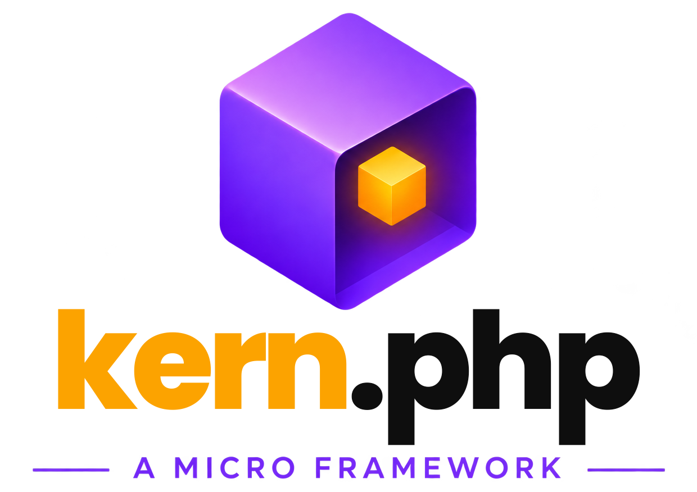

  

# kern.php - A lightweight PHP microframework

*A small framework with a solid foundation.*

kern is a lightweight PHP microframework focused on simplicity, modularity, and understanding the foundations of modern PHP application architecture.

Built from scratch as a personal learning project, kern aims to provide the essential building blocks for web applications without the complexity of a full-stack framework.

## Table of contents

- [Overview](#overview)
- [Design principles](#design-principles)
- [Planned features](#planned-features)
- [Roadmap](#roadmap)
- [Tech stack](#tech-stack)
- [AI Usage & Attribution](#ai-usage--attribution)

## Overview

kern is an experimental PHP microframework designed to explore the fundamental components of modern web frameworks.

Rather than providing a large collection of built-in features, kern focuses on a small, understandable core that can be extended with external Composer packages when needed.

## Design principles

- **Lightweight** — keep the core small and focused.
- **Modular** — separate responsibilities into independent components.
- **Explicit** — prefer understandable code over hidden framework magic.
- **Extensible** — integrate external packages instead of expanding the core unnecessarily.
- **Standards-oriented** — follow established PHP standards where appropriate.
- **Educational** — prioritize understanding architectural decisions.

## Planned features

| Component | Responsibility |
| --- | --- |
| **Application** | Coordinate initialization and the request lifecycle |
| **Router** | Match HTTP requests to registered routes |
| **Request** | Represent incoming HTTP requests |
| **Response** | Build and return HTTP responses |
| **Middleware** | Process requests through a configurable pipeline |
| **Dependency Injection Container** | Manage object creation and dependencies |
| **Error Handling** | Handle exceptions and HTTP errors consistently |

The router is already available in a basic form. The remaining components are planned and will be added incrementally.

## Roadmap

kern is developed incrementally, focusing on the essential building blocks of a lightweight PHP microframework.

- [x] Project setup
- [ ] Basic HTTP router
- [ ] HTTP request and response handling
- [ ] Middleware support
- [ ] Dependency injection container
- [ ] Error and exception handling
- [ ] Automated testing and CI
- [ ] Documentation and first release

The goal is to keep kern small, understandable, and extensible rather than turning it into a full-stack framework.

## Tech stack

- **PHP** — framework implementation
- **Composer** — dependency management and autoloading
- **[marclang64/php-tooling](https://github.com/marclang64/php-tooling)** — reusable package for PHP development tooling and code quality
  - **PHPUnit** — automated testing
  - **PHPStan** — static code analysis
  - **PHP-CS-Fixer** — code formatting
  - **GitHub Actions** — planned continuous integration

## AI Usage & Attribution

AI tools have been used for selected supporting materials and as a learning resource:

- **Logo:** Generated with AI.
- **Documentation:** The README was drafted and refined with AI assistance.

**All application source code is written manually by me.**

AI serves as a technical discussion partner and documentation aid, not as the author of the framework's implementation. This disclosure will be updated if the project's use of AI changes.
